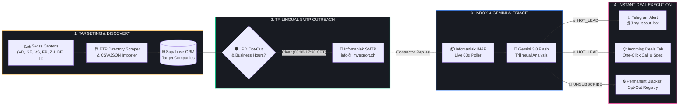
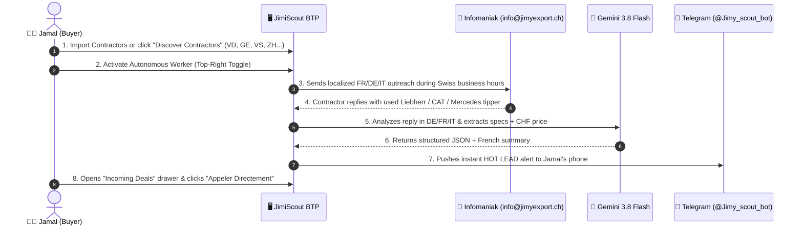

<div align="center">

<!-- Animated SVG Header Banner -->


<p align="center">
  
  
  
  
  
</p>

> **Industrial Field Manual & Complete Operator Guide**  
> Built for **Jimi Export (Switzerland)** — Automated sourcing of excavators, 4-axle tipper trucks, wheel loaders, and crushers directly from Swiss civil engineering (*Génie Civil / Tiefbau / Edilizia*) contractors.

</div>

---

## 🧭 Table of Contents

1. [⚡ How the Autonomous Loop Works (Visual Architecture)](#-1-how-the-autonomous-loop-works-visual-architecture)
2. [🎛️ Tab-by-Tab Operator Guide](#-2-tab-by-tab-operator-guide)
   - [Tab 1: Incoming Deals (CRM & Deal Sheet Drawer)](#tab-1-incoming-deals-crm--deal-sheet-drawer)
   - [Tab 2: Mission Control (Autonomous Worker & Live Testing)](#tab-2-mission-control-autonomous-worker--live-testing)
   - [Tab 3: Email Persona (Buyer Identity & Trilingual Templates)](#tab-3-email-persona-buyer-identity--trilingual-templates)
   - [Tab 4: Target Criteria (Equipment Specs & Canton Routing)](#tab-4-target-criteria-equipment-specs--canton-routing)
   - [Tab 5: Suppression & Opt-Out Registry (Swiss LPD/DSG Shield)](#tab-5-suppression--opt-out-registry-swiss-lpddsg-shield)
3. [🚀 Daily 5-Minute Workflow for Jamal](#-3-daily-5-minute-workflow-for-jamal)
4. [🤖 How Gemini AI Classifies Contractor Replies](#-4-how-gemini-ai-classifies-contractor-replies)
5. [🔌 Live Infrastructure & Credentials Reference](#-5-live-infrastructure--credentials-reference)

---

## ⚡ 1. How the Autonomous Loop Works (Visual Architecture)

JimiScout BTP runs a **4-stage continuous acquisition pipeline** that discovers Swiss construction firms, sends human-paced acquisition emails in the contractor's native canton language (`FR`, `DE`, `IT`), monitors your `info@jimyexport.ch` inbox via IMAP, and pushes instant mobile alerts to your Telegram when a contractor has machines to sell.



---

## 🎛️ 2. Tab-by-Tab Operator Guide

The top navigation bar gives you instant access to **5 specialized command views**, plus live status indicators in the top-right corner (**Swiss CET Clock**, **Agent Active/Paused Switch**, and **New Deal Counter**).

---

### Tab 1: `Incoming Deals` (CRM & Deal Sheet Drawer)


This is your primary deal-closing workspace. Every time a Swiss contractor replies with machinery for sale (or when you test via IMAP/Injector), the lead appears here automatically.

* **KPI Summary Strip**: Displays **Total Deals**, **New Unread Replies**, **Contacted / Negotiating**, **Closed Won**, and **Active Cantons**.
* **Search & Status Filters**: Filter leads by machine brand (`Liebherr`, `CAT`, `Volvo`, `Komatsu`), company name, canton, or deal stage (`New`, `Contacted`, `Closed`).
* **Interactive Deal Sheet Drawer**: Click any row in the table to slide open the right-hand **Inspection Drawer**:
  * 📞 **Appeler Directement**: One-click `tel:+41...` button to call the fleet manager immediately.
  * ✉️ **Répondre par Email**: Opens your mail client pre-addressed to the seller with the original subject line.
  * 🚜 **Machinery Detected Cards**: Displays every machine Gemini extracted from the email (*Type, Brand/Model, Year, Hours, and Asking Price in CHF*).
  * 🇫🇷 **Synthèse IA (French Executive Summary)**: Even if the contractor wrote in Swiss-German (*Deutsch*) or Italian (*Italiano*), Gemini translates and summarizes the commercial offer into clear French.
  * 🔄 **Stage Selector**: Mark the deal as `Nouveau`, `En cours (Contacté)`, `Acquis (Gagné)`, or `Archivé`.

---

### Tab 2: `Mission Control` (Autonomous Worker & Live Testing)


Mission Control lets you monitor and trigger every engine in real time:

| Action Button | What It Does | When to Use It |
| :--- | :--- | :--- |
| **🟢 Démarrer / Pause Agent** | Toggles the background autonomous worker on or off. | Keep **Active** during the week so outreach and inbox polling run automatically. |
| **📤 Send Next Email Now** | Picks the next queued contractor from your target list and sends a real localized email via `info@jimyexport.ch` (`mail.infomaniak.com`). | Use anytime you want to immediately dispatch the next outreach email without waiting for the timer. |
| **📬 Poll IMAP Inbox** | Connects to `mail.infomaniak.com:993`, reads all unread replies in `info@jimyexport.ch`, runs Gemini triage, saves leads, and fires Telegram alerts. | Click whenever you want an immediate inbox check (also runs automatically every 60 seconds). |
| **📲 Test Telegram** | Sends a live verification alert to `@Jimy_scout_bot` (Chat ID `6815209178`). | Use to verify mobile push notifications on your phone. |
| **🔍 Discover Contractors** | Scrapes real public Swiss civil engineering companies by canton (`VD`, `VS`, `GE`, `FR`, `BE`, `ZH`, `TI`) from OpenStreetMap Overpass & public web directories. | Use when expanding into a new Swiss canton to populate your target queue. |
| **📂 Import Prospects** | Bulk-import your own list of Swiss BTP contractors via CSV or JSON (`Company Name, Email, Canton, Website, Phone`). | Use to upload existing contractor lists or trade show directories. |
| **🧪 Test Reply Injector** | Lets you paste or load a realistic German, French, Italian, or Opt-Out contractor reply and run it through the live Gemini + Telegram + CRM pipeline. | Ideal for testing how Gemini extracts machinery specs without sending an external email. |

---

### Tab 3: `Email Persona` (Buyer Identity & Trilingual Templates)


Configure how your outreach emails look and test them directly in your inbox:

1. **Buyer Identity Fields**:
   * **Sender Name**: e.g., `Jamal`
   * **Company Name**: e.g., `JimiScout BTP — Négoce & Acquisition Matériel Suisse`
   * **Sender Email**: `info@jimyexport.ch`
   * **Direct Phone**: Your Swiss mobile number for fleet managers who prefer calling directly.
   * **Equipment Focus**: Automatically injected into the email body across all three languages.
2. **Live Trilingual Preview (`FR` / `DE` / `IT`)**:
   * Switch between **Français (Romandie)**, **Deutsch (Deutschschweiz)**, and **Italiano (Ticino)** to inspect the exact subject line, body copy, and mandatory Swiss LPD/DSG compliance footer.
   * Click **Save Persona Config** to persist changes across all future outreach.
3. **Send Live SMTP Test Email**:
   * Enter any recipient email address (e.g., `info@jimyexport.ch` or your personal email), choose `FR`, `DE`, or `IT`, and click **Send Live Test**.
   * Dispatches a real email through `mail.infomaniak.com` and returns the live SMTP `Message-ID`.

---

### Tab 4: `Target Criteria` (Equipment Specs & Canton Routing)

Configure your acquisition parameters and daily volume guardrails:

* **Machinery Categories**: Toggle target equipment classes (*Tracked Excavators 15–35t, 4-Axle Tipper Trucks, Wheel Loaders, Mobile Crushers, Articulated Dumpers*).
* **Preferred Brands**: Prioritize top export brands (*Liebherr, Caterpillar, Volvo, Komatsu, Hitachi, Mercedes-Benz Arocs, MAN, Scania*).
* **Active Swiss Cantons**: Select which cantons are targeted and see their automatic language routing:
  * 🇫🇷 **French**: `VD`, `GE`, `VS`, `FR`, `NE`, `JU`
  * 🇩🇪 **German**: `ZH`, `BE`, `LU`, `AG`, `SG`, `BS`, `BL`, `SO`, `TG`, `ZG`, `SZ`, `GR`
  * 🇮🇹 **Italian**: `TI`
* **Daily Outreach Cap**: Set the maximum number of cold emails sent per day (default: `25/day`) with randomized human-like jitter (`8–22 min`) to protect your `jimyexport.ch` domain reputation.

---

### Tab 5: `Suppression` (Swiss LPD/DSG Opt-Out Registry)

Protects your business under the **Swiss Federal Act on Data Protection (LPD / DSG)**:

* **Automatic AI Unsubscribe**: If a contractor replies with *"STOP"*, *"Désinscription"*, *"Bitte keine Mails mehr"*, *"Abmelden"*, or *"Cancella"*, Gemini classifies the email as `UNSUBSCRIBE` and immediately locks their email and domain in this registry.
* **Manual Blacklist**: Add any email address or domain (`@example.ch`) manually at any time—the SMTP worker checks this table before every single dispatch.

---

## 🚀 3. Daily 5-Minute Workflow for Jamal



---

## 🧠 4. How Gemini AI Classifies Contractor Replies

Every incoming email to `info@jimyexport.ch` is evaluated by `gemini-3.8-flash` (with automatic failover to `gemini-flash-latest` and `gemini-2.5-flash`) using a strict JSON schema:

<details>
<summary><b>🔥 Click to view example JSON output produced by Gemini Triage</b></summary>

```json
{
  "intent": "HOT_LEAD",
  "confidence": 0.98,
  "equipment_fit_score": 95,
  "machinery_detected": [
    {
      "type": "Pelle sur chenilles",
      "make_model": "Liebherr R926 Compact",
      "year": 2018,
      "hours": 6450,
      "asking_price": "CHF 68'000"
    },
    {
      "type": "Camion benne 4 essieux",
      "make_model": "Mercedes-Benz Arocs 3245",
      "year": 2017,
      "hours": 185000,
      "asking_price": "CHF 59'000"
    }
  ],
  "contact_name": "Marc Rochat",
  "contact_phone": "+41 21 802 44 19",
  "french_summary": "Marc Rochat propose une pelle Liebherr R926 Compact (2018, 6'450h) à 68'000 CHF et un camion benne Mercedes Arocs 3245 (2017) à 59'000 CHF, disponibles fin du mois à Morges."
}
```
</details>

| Intent Classification | Trigger Condition | Automated System Action |
| :--- | :--- | :--- |
| **`HOT_LEAD`** | Contractor offers equipment, asks for valuation, or invites an inspection. | Saves to **Incoming Deals**, extracts machine cards, translates summary to French, and sends **Telegram Alert**. |
| **`NEEDS_REVIEW`** | Contractor replies with ambiguous details or asks a question. | Saves to **Incoming Deals** with a `Needs Review` badge for human follow-up. |
| **`NOT_INTERESTED`** | Contractor politely declines or has no machines available right now. | Marks prospect as `no_stock_temporarily` with a 30-day cooldown (does not permanently blacklist). |
| **`UNSUBSCRIBE`** | Contractor asks to be removed (`STOP`, `Abmelden`, `Désinscription`). | Permanently adds email to **Suppression Registry** and halts all future outreach. |
| **`OUT_OF_OFFICE`** | Automated vacation or absence responder. | Logs notice without triggering false-positive Telegram alerts. |

---

## 🔌 5. Live Infrastructure & Credentials Reference

All 5 external services are pre-configured and verified in your environment:

| Service | Host / Endpoint | Active Account / Identifier | Status |
| :--- | :--- | :--- | :--- |
| **Outbound SMTP** | `mail.infomaniak.com:587` (STARTTLS) | `info@jimyexport.ch` | 🟢 **LIVE** |
| **Inbound IMAP** | `mail.infomaniak.com:993` (SSL/TLS) | `info@jimyexport.ch` | 🟢 **LIVE** |
| **AI Triage Engine** | Google GenAI SDK | `gemini-3.8-flash` + `gemini-flash-latest` / `gemini-2.5-flash` fallback | 🟢 **LIVE** |
| **Mobile Alerts** | Telegram Bot API | `@Jimy_scout_bot` | 🟢 **LIVE** |
| **Database & CRM** | Supabase Cloud + Local Sync | PostgreSQL with RLS | 🟢 **LIVE** |

---

<div align="center">
  <sub><b>JimiScout BTP</b> — Engineered for Swiss Heavy Machinery Acquisition & Export</sub>
</div>
